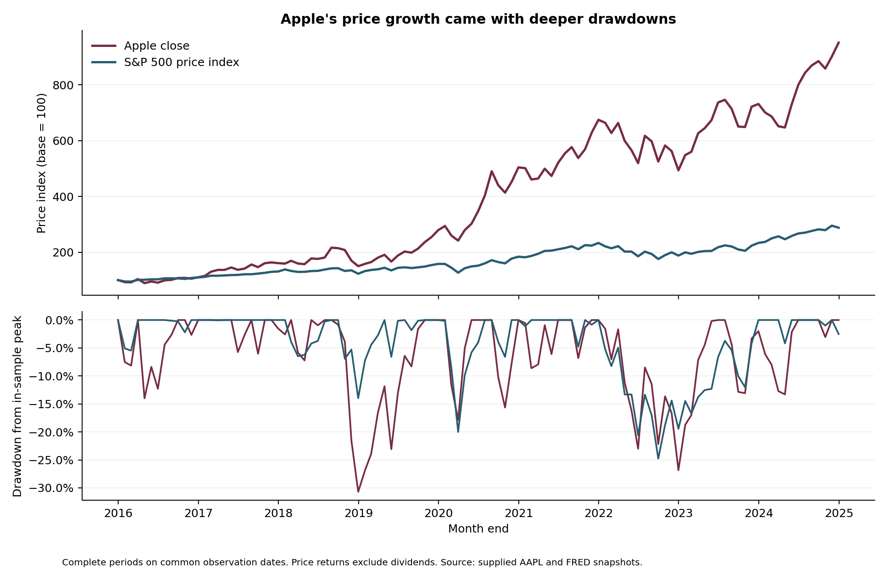

# Apple Equity Risk and Macroeconomic Context

**Grace Ngo | Dickinson College | DATA 200 coursework, Fall 2025**  
Reviewed publication: November 2026. Historical data end in January 2025 for Apple; this is not a live market dashboard.

How much downside exposure accompanied Apple's historical price growth, and how did its monthly outcomes differ across macroeconomic environments?

This project combines an offline, reproducible Python pipeline with FRED economic series, a common-date market comparison, drawdown episodes and documented data-quality controls. It extends the original price-and-volume exploration into a focused equity-risk research brief. The intended use is historical risk discussion and analytical review.

## Findings

The benchmark comparison uses **108 complete return months**, January 2016 through December 2024, with a December 31, 2015 baseline. Both series use prices rather than a mixture of adjusted and unadjusted return conventions.

| Measure | Apple close | S&P 500 price index |
| --- | ---: | ---: |
| Cumulative price return | 851.6% | 187.8% |
| Annualized geometric price return | 28.4% | 12.5% |
| Annualized monthly volatility | 28.1% | 15.5% |
| Maximum month-end drawdown | -30.7% | -24.8% |
| Worst monthly return | -18.4% | -12.5% |

Apple experienced greater volatility and a deeper maximum month-end drawdown in this window. However, its geometric downside-capture ratio was **85.2%** across the 34 months when the index fell. These measures answer different questions: the deepest cumulative decline need not occur in the same observations as the average down-market result. A single headline return conceals that distinction.



The longer Apple sample covers **300 monthly returns, 2000-2024**. Under an illustrative definition of a rising-rate environment, a contemporaneous 12-month increase in FEDFUNDS of at least one percentage point, Apple's mean monthly price return was **0.49% across 57 months**. For changes strictly between -1 and +1 percentage point, it was **3.47% across 191 months**. These are retrospective associations across unequal samples and market eras. They do not identify the effect of monetary policy or establish an investment rule.

Full results: [summary](reports/summary.json), [regime comparisons](reports/regime_summary.csv), [daily drawdown episodes](reports/drawdown_episodes.csv), and [executed notebook](aapl_analysis.ipynb).

## Analytical design

1. **Validate source observations.** Check required columns, unique dates, finite numeric values, positive prices, OHLC consistency and binary recession labels. Represent missing calendar periods explicitly.
2. **Use complete periods.** Exclude each daily snapshot's terminal month conservatively. The Apple file ends January 3, 2025, so January 2025 is excluded rather than compared with a full benchmark month.
3. **Align actual trading dates.** Inner-join the daily equity and benchmark series before selecting the last common date in each month. Do not forward-fill unavailable benchmark history or interpolate missing prices.
4. **Keep return definitions explicit.** Use `Close` for the price-index comparison. Retain `Adj Close` separately in the context table. Do not describe a dividend-excluding benchmark as a total-return index or an arithmetic return difference as risk-adjusted alpha.
5. **Separate descriptive context from investable information.** CPI inflation uses a 12-calendar-month change. GDP growth uses a four-quarter change. FEDFUNDS regimes use a 12-month percentage-point change. USREC describes periods dated retrospectively. Revised snapshots and contemporaneous labels cannot support a point-in-time backtest.

The 4% inflation cutoff and +/-1 percentage-point rate thresholds are explicit analytical choices, not official regime definitions. Counts, medians, negative-month shares and worst months accompany the means. No model selects these thresholds to maximize investment performance.

## Reproduce

Python 3.11 or later. Run from the repository root:

```sh
python -m venv .venv
source .venv/bin/activate
python -m pip install -r requirements.txt
python -m equity_review.analysis
python -m unittest discover -s tests -v
```

On Windows, activate with `.venv\Scripts\activate`. The default analysis requires no API key or network connection. For another output directory:

```sh
python -m equity_review.analysis --data data/snapshots --output /tmp/equity-review
```

To open the notebook, install the optional environment with `python -m pip install -e '.[notebook]'` and start JupyterLab from this directory. The notebook's code cells were executed sequentially and its saved outputs checked; native Jupyter kernel launch was unavailable in the publication environment.

## Data and refresh

Six supplied coursework snapshots are stored in [data/snapshots](data/snapshots). [The source manifest](docs/source_manifest.json) records their hashes, coverage and series definitions. Source snapshots remain separate from derived results. They have not been refreshed to 2026.

| File | Interpretation | Frequency |
| --- | --- | --- |
| `apple_stock.csv` | Historical Apple OHLCV, Close and Adj Close | Trading days |
| `fred_sp500.csv` | SP500 price index, excluding dividends | Trading days |
| `fred_cpi.csv` | CPIAUCSL index level; inflation is calculated | Monthly |
| `fred_fedfunds.csv` | FEDFUNDS effective rate, percent | Monthly |
| `fred_recession.csv` | USREC, retrospective recession indicator | Monthly |
| `fred_gdp.csv` | GDPC1 real GDP, chained-dollar level at annual rate | Quarterly |

The optional `equity_review.fred.fetch_observations` helper reads `FRED_API_KEY` from the environment, applies a timeout, validates the response and suppresses credential-bearing request URLs in errors. A refresh must be saved as a new documented snapshot and reviewed for coverage changes. It does not silently overwrite published results. A historical-vintage study would require ALFRED or equivalent release-time information.

Data rights remain with their respective providers. The vendor, retrieval date and redistribution terms for the Apple extract were not supplied. FRED's SP500 series has provider-specific terms; no blanket open-data license is asserted here. These files were supplied with the coursework and were already present in this repository.

## Engineering and verification

- A small importable package separates validation, calendar alignment, risk calculations, plotting and optional retrieval.
- Ten automated tests cover partial months, missing periods, duplicate dates, running peaks, censored recovery, independent endpoint reconciliation and credential-safe errors.
- GitHub Actions reruns tests and the full offline analysis on pushes and pull requests.
- Reports include input SHA-256 hashes and package versions. Tables reconcile with the supplied data, rather than relying on saved narrative claims.

## Interpretation limits

This is one surviving company's historical sample. It excludes dividends, fees and taxes in the market comparison. The source's split-adjusted price convention is inferred from its historical values, not independently verified against a vendor specification. Annualized volatility uses the square-root-of-time convention; month-end drawdowns omit intramonth extremes. Macroeconomic observations are revised and recession dates become known later. The project does not estimate causal effects, risk-adjusted alpha, fair value or a profitable trading strategy.

[Publication changes](docs/methodology.md) explain why several conclusions in the original coursework were narrowed. The current analysis and portfolio use the same definitions and results.

## Structure

```text
equity_review/      Validation, analysis, plotting and optional FRED client
data/snapshots/     Unmodified supplied input files
reports/           Rebuilt tables, figures and summary
tests/             Behavioral and reconciliation checks
docs/              Source manifest and methodological decisions
aapl_analysis.ipynb Executed research notebook
```

## References

- [FRED: S&P 500 definitions and provider notes](https://fred.stlouisfed.org/series/SP500)
- [FRED: USREC period convention](https://fred.stlouisfed.org/series/USREC)
- [FRED: real GDP definitions](https://fred.stlouisfed.org/series/GDPC1)
- [FRED: CPIAUCSL](https://fred.stlouisfed.org/series/CPIAUCSL)
- [FRED: FEDFUNDS](https://fred.stlouisfed.org/series/FEDFUNDS)
- [FRED: API observations documentation](https://fred.stlouisfed.org/docs/api/fred/series_observations.html)
- [NBER: business-cycle dates](https://www.nber.org/research/data/us-business-cycle-expansions-and-contractions)

[Portfolio case study](https://graciendx.github.io/case-studies/apple-equity-risk.html) | [Grace Ngo's portfolio](https://graciendx.github.io/)
